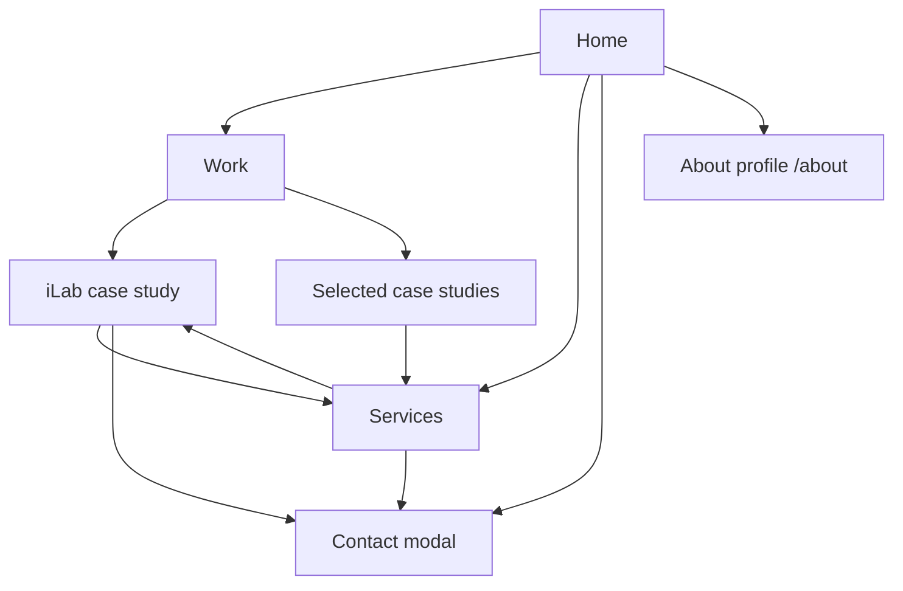

# Askold website — project plan

Updated: 2026-11-23. Milestones 1, 2, 2.1 and 3 are implemented. The current homepage is **broadly approved and protected**. The Services direction, owner-selected examples and iLab reporting evidence are implemented for manual review. Local development only; no Milestone 4, production deployment or final QA is authorized.

## Services-only redesign — implemented, pending manual review

The complete Services brief supersedes the previous Services layout. The configured Designer (GPT-6 Astra/high) applied the four requested installed skills and supplied the composition; the Explorer researched original assets and descriptions; the Implementer authored the five application files. The orchestrator coordinated scope, preserved recovery files, checked protected-source hashes and updated documentation.

The preserved looping capital hero now leads directly to a seven-row editorial service directory. All seven canonical service anchors remain intact. The page continues through a bronze identity wall, an ivory web-design spread, a black technical selector, compact charcoal SEO/support rows and the existing default `PageInquiry` once. No repeated service contact buttons or separate process chapter. Metadata describes the complete offering.

The identity wall reuses FixMobile business cards, the MasterBean identity, SeoQuill identity and BTX Black Friday campaign. Small FRIO ESTRELLA evidence, a LATVIR link, SeoQuill ordering and an iLab commerce reference support the relevant offers. No new image derivatives, fabricated screens, analytics or achievements. The MasterBean packaging image with unclear small copy is deliberately excluded; authentic original asset sources and dimensions are recorded in `ASSET_MANIFEST.md`.

The technical chapter keeps custom development, e-commerce and web applications individually identifiable. Native hashes select the corresponding article before anchor scrolling; manual keyboard controls and history synchronization use no scroll locking. Server-rendered articles reserve a stable grid height; no-JavaScript content remains readable in normal flow. Initial content does not fade, subsequent selections use a short opacity transition, and reduced motion removes it. These are source-verified implementations, not claims of completed browser testing.

Application files: `src/app/services/page.tsx`, `src/app/services/page.module.css`, and new `src/components/services/services-content.ts`, `technical-selector.tsx`, `technical-selector.module.css`. Existing shared service records, homepage, other routes, artwork/video components, navigation, footer, modal, Resend, dependencies and assets are unchanged by this pass. A SHA-256 comparison against the recovery manifest found only the two Services route files and three project documents changed, three intended Services component files added, and no missing files.

Recovery point: Git HEAD `ba4585d40707d22b0f8fe97278b0fe31a2d626a6` plus a verified 218-file pre-pass working-tree snapshot (19,979,129 bytes) in Git-ignored `.taste-skill/services-redesign/recovery/`. The manifest, Git status and tracked binary diff preserve the existing uncommitted state. This is a recovery snapshot, not a new commit; `.env.local` was excluded and not read.

TypeScript and focused ESLint passed. Both CSS modules parsed; seven unique canonical anchor destinations, one shared inquiry CTA and six literal image dimensions passed source checks. No browser checks, screenshots, QA agents, audits, full regression suite, production build or dev server were run. No reference repository, hosting or DNS changes. Rendered desktop/mobile composition and interaction approval remain for the user's manual review. Stop after this implementation; final QA and Milestone 4 remain unauthorized.

### Services project-example follow-up

The owner approved the page direction and requested different evidence. Preserve the complete Services structure, hero, copy, directory, typography, backgrounds and shared CTA. Replace the identity wall with a manual carousel containing FixMobile, SeoQuill and MasterBean, each represented by multiple original assets. Web design shows iLab/FixMobile; custom development shows iLab/FRIO ESTRELLA; e-commerce shows the iLab parts shop/MasterBean; web applications retains SeoQuill ordering. Existing native fragments and technical-selector behavior remain intact. No shared project data or other-page redesign is in scope.

The orchestrator applied the installed taste skill within the approved direction, verified the additional original asset sources and inspected their existing derivatives. The Implementer owns application changes. A focused recovery copy of Services files and the three project documents, with hashes for 221 pre-pass working files, is retained in Git-ignored `.taste-skill/services-examples-before/`; `.env.local` is excluded. No QA, browser audit, production build or deployment is authorized by this follow-up.

Implemented: three assets per brand in a native horizontal scroll-snap carousel, with brand selectors, previous/next controls, keyboard arrows, swipe access, no autoplay and reduced-motion handling. JavaScript-free scrolling remains available. Compact paired examples replace the prior web-design evidence and extend technical proofs; the iLab commerce reference opens `https://ilab.lv/shop` with a separate case-study link. Services copy, hero, service order and technical selection controller remain unchanged. TypeScript and focused ESLint passed; three CSS modules, brand order, 15 unique image dimensions and old-wall removal passed source checks. Snapshot hashes confirm only five existing Services files and three project documents changed, with two carousel files added and no files missing. No browser checks or production build were run; rendered composition and gestures await manual review.

### iLab reporting evidence — owner-supplied screenshots

The owner supplied two aggregate screenshots and authorized their use in the existing iLab SEO evidence slots, with suitable Services reuse. Replace the empty slots with the Google Analytics activity chart and Google Search Console October 2026/October 2025 comparison. Present readable English metric/source captions, wide uncropped images and full-size links. Keep the reporting periods distinct: Search Console is a dated year-over-year comparison; the Analytics screenshot does not show an exact cutoff/comparison range or organic-only filter. Do not infer causal SEO results or calculate precise growth from rounded figures. Services reuses only the compact Search Console evidence in the SEO offer, linked to the complete case. No tracking, account access or change to the guarded result-band contract.

The Implementer owns application/media changes; the orchestrator maintains evidence documentation and scope verification. A focused pre-pass recovery copy and 223-file hash manifest are retained in Git-ignored `.taste-skill/ilab-seo-evidence-before/`, excluding `.env.local`. All other page compositions, animation, carousel, contact delivery and original-reference assets remain protected. No browser QA, production build, deployment or Milestone 4 is authorized by this update.

Implemented in six source files plus two unchanged JPEGs under `public/media/evidence/`. Shared typed evidence constants supply the case reports and SEO-only Services figure. TypeScript, focused ESLint, CSS parsing, native image dimensions and SHA-256 copy checks passed. A working-tree hash comparison found only the six intended source files and three evidence documents changed, with the two JPEGs added and no missing files. Other project records and the Services hero/directory/branding/web/technical chapters remain unchanged. No browser checks, production build or provider calls were run; rendered presentation remains for manual review.

### Selected-work order — owner refinement

Move MasterBean and SeoQuill to the beginning of the homepage carousel, followed by FRIO ESTRELLA, FixMobile, LATVIR, RubinRub and BTX Outlet. The Work page retains iLab as flagship, uses this same curated order, and keeps Stefanel Riga last. FixMobile separates FRIO ESTRELLA and LATVIR to vary the project imagery. Keep all existing projects, category filtering, case content, layout and carousel behavior unchanged; the base project records remain in their existing order.

### RubinRub internal-dashboard expansion

Expand RubinRub's existing case with the owner-confirmed internal dashboard: expense and purchase tracking, stock management and dish calculations. Retain all existing WordPress, promotional and established-identity content, imagery and film; add the supplied sign-in and dish-management screenshots under descriptive filenames. Update the shared project scope/summary and include RubinRub in the existing Custom development Work filter, without changing curated project ordering, page layouts, Services or other cases. No dashboard stack, security implementation, integrations or quantified outcomes are supplied or invented. Original Downloads files and the reference repository remain unchanged. Application/media edits belong to the Implementer; documentation belongs to the orchestrator. No browser QA, build or deployment is authorized by this content update.

Implemented in `src/content/projects.ts` and `src/content/work-categories.ts`, with two unchanged JPEG copies in `public/media/work/`. TypeScript, focused ESLint, image dimensions and byte-identical SHA-256 checks passed. The original three RubinRub sections, assets and video, eight other project records and curated Work/carousel ordering are preserved. Focused backups are retained in Git-ignored `.taste-skill/rubinrub-dashboard-before/`. No browser checks or build were run; stop for manual review.

### Numoscape, Dexicon and RubinRub promotion

Add `/work/numoscape` as a numerology-platform case covering the multi-tool reading journey, calculations and owner-confirmed payment integration. Use its three supplied screenshots without inventing providers, stack, revenue, scientific accuracy or transaction verification. Add `/work/dexicon` as a concise business-presentation **web-design-only** case, using the supplied homepage screenshot; no development or financing implementation is claimed. Both cases reuse the current template, project metadata, static-parameter generation, sitemap and related-work architecture. No unprovided external URLs or project metrics are published.

RubinRub now leads the homepage carousel and follows flagship iLab on Work. Curated Work order: iLab, RubinRub, MasterBean, Numoscape, SeoQuill, FRIO ESTRELLA, FixMobile, LATVIR, Dexicon, BTX Outlet, Stefanel Riga. The homepage carousel excludes iLab and Stefanel, retaining nine projects; FixMobile still separates FRIO ESTRELLA/LATVIR. Numoscape joins Custom development and Dexicon joins Business websites, with design-only attribution. Four original JPEGs are copied under descriptive filenames, leaving the Downloads originals intact. Keep low-resolution full-page captures at native-or-smaller width; Dexicon uses a bounded introductory CSS preview and the complete design below. Preserve all existing project records, artwork, contact behavior, Services and carousel controller.

The Implementer owns application/media changes and focused integrity checks; the orchestrator applies the existing frontend design direction and maintains documentation. No new art direction or generated artwork, production hosting/DNS change, final QA or Milestone 4 is authorized. No browser checks or production build are part of this pass.

Implemented in `src/content/projects.ts`, `src/content/work-categories.ts` and the shared case-study TSX/CSS module, plus four unchanged JPEG copies. The shared rendering adjustment only frames very tall covers and caps portrait figures at their native width; the existing nine project records are unchanged. TypeScript, focused ESLint, CSS parsing, image dimensions and byte-identical copy checks passed. Source checks confirm 11 unique cases, nine carousel projects, requested ordering/category membership and existing data-driven route, metadata, sitemap and related-work coverage. Focused source backups and hashes are retained in Git-ignored `.taste-skill/new-projects-before/`. No browser checks or build ran; stop for manual review.

### Mobile hero pacing refinement

The owner requested a substantially quicker mobile hero, aiming for a few natural swipes. At widths up to 760px, reduce active animation travel from 250svh to 100svh; the 100svh stage and its native departure remain, reducing the hero footprint from 350svh to 200svh. Preserve the original sculpture/bonsai sequence, typing, phase proportions, seek optimization, framing, native reversible scrolling and reduced-motion/static fallbacks. Normal desktop retains 400svh travel; short desktop windows retain their existing 250svh compact travel. The mobile final video frame and headline arrive earlier in absolute scroll distance. This is a targeted pacing iteration awaiting manual review, not final QA or Milestone 4 authorization.

Implemented by the Implementer in the hero controller, with separate mobile and compact-desktop distance constants. TypeScript, focused lint and source/formula checks passed. No browser checks, production build, animation redesign, commit or push were performed for this pass.

Mobile copy follow-up: keep only the greeting and “Let's make your ideas visible.” Hold the second phrase through the bonsai reveal and exit, without erasing it for the desktop-only “Then make them work for your business.” transition. Mobile width measurement excludes the unused third phrase. Preserve the shortened mobile scroll range and the existing three-message desktop sequence, including short desktop windows.

### Mobile first-scroll playback — supersedes mobile seeking

The owner reports glitchy mobile scroll-linked playback and requests a simpler first-scroll sequence. Replace mobile frame seeking with one native muted inline playback of the original film, triggered by the first scroll while the hero is visible. Use a short independent greeting-to-idea typing sequence and hold the idea headline; keep the original subline throughout. Remove mobile animation scroll distance/sticky hold and the visible scroll cue, preserving a keyboard-reachable continuation link. Pause/resume for offscreen or hidden-page conditions, hold the final bonsai, and keep reduced-motion and media-failure fallbacks. Preserve sculpture dimensions and all desktop scroll behavior. The Implementer owns hero/controller changes; the orchestrator applies the installed `web-perf` skill through source inspection and maintains documentation. No browser audits, QA agents, production build or deployment are authorized by this iteration. Manual phone review remains required.

Implemented in the hero TSX/CSS and a focused `mobile-first-scroll.ts` helper. Eight pixels of downward scrolling starts native playback at 0.75 speed (approximately 1.35 seconds), with direct text-node typing updates and no mobile scroll seeks or per-frame React updates. TypeScript, focused ESLint, CSS parsing and a mocked playback-lifecycle check passed; these checks do not establish rendered phone smoothness. Recovery copies and the local mock harness remain Git-ignored in `.taste-skill/mobile-first-scroll-before/`. No other homepage sections, dependencies, assets or production settings changed.

Mobile correction after owner review: preserve a perceptible typing/erasing sequence independently of the film's end event. Returning to the top must reverse the original sculpture and restore the greeting, then allow another downward-scroll reveal. Keep the short normal-flow hero, fixed subline and hidden cue. Remove the inherited desktop scroll-cue padding so mobile CTAs sit at the hero's bottom with safe-area clearance, without overlaying later sections. Desktop and the rest of the homepage remain outside this correction.

Implemented by the Implementer in the same three hero files: 0.65-second greeting erasure plus 1.65-second idea typing; native forward film playback; elapsed-time reverse seeks gated by readiness and decoder availability. Returning within 2px of the top starts reversal; 8px of renewed downward travel resumes forward from the current state. Typing completes independently of film completion. Pause/resume, completed-frame restoration on breakpoint changes and cleanup remain covered by source lifecycle checks. Mobile CTAs remove the inherited 52px scroll-cue padding and retain the existing safe-area inset. TypeScript, focused ESLint, CSS parsing and source lifecycle/boundary checks passed; no browser checks, production build, commit or push. Rendered reverse smoothness and CTA placement await manual phone review.

Owner rejected the independent playback/reverse iteration after phone review: the hero left before typing completed and reverse playback was slow and glitchy. Supersede it with a compact scroll-synchronized mobile scene using the shared guarded seek pipeline. Approximately 90svh of sticky active travel finishes both the two-message typing and original film before native departure; reverse follows scroll progress directly. Remove the independent mobile helper and its timed reverse loop. Keep the fixed subline, hidden cue, bottom CTAs, approved artwork framing, static fallbacks and all desktop behavior. No wheel/touch interception, new assets, dependencies, production changes or final QA are authorized.

Implemented by the Implementer in the hero controller and CSS, removing `mobile-first-scroll.ts`. Mobile uses `scrub: true`, original-frame-quantized/coalesced seeks, zero artwork ascent and a 190svh total footprint (90svh active travel plus the 100svh stage). The idea phrase finishes at 36svh and the film at approximately 65svh of active travel, before release at 90svh. Desktop retains its original 400/250svh travel, 0.3-second scrub and phase definitions. TypeScript, focused lint, CSS parsing and source checks passed. No browser checks, production build, commit or push; rendered mobile smoothness awaits manual review.

## Current QA policy — explicit final approval required

This policy supersedes all previous milestone-based QA schedules in `AGENTS.md` and project documentation. No intermediate milestone automatically triggers QA. Historical QA/build records below describe past work and do not authorize future testing. These restrictions apply to the orchestrator, specialists and skill workflows alike.

### Development phase

- Do NOT spawn the QA agent or invoke `visual_qa`, `functional_qa` or similar testing/review agents.
- Do NOT run browser-based QA after individual changes.
- Do NOT automatically perform visual audits or screenshot comparisons.
- Do NOT run Lighthouse, accessibility or SEO audits.
- Do NOT run full regression tests.
- Do NOT create QA reports after each implementation pass.
- Do NOT repeatedly run production builds.

The Implementer may run targeted TypeScript or lint checks when necessary to catch errors. Run a production build only at significant integration checkpoints or when explicitly requested.

### Final QA phase

Activate QA only after the user explicitly approves that the entire website is finished and ready for final testing. Do not begin final QA without that authorization; completing any milestone, including release-candidate preparation, does not supply it.

Once authorized, final QA includes browser and responsive tests, functional tests, an accessibility audit, performance and Core Web Vitals review, an SEO audit, cross-browser review and a final production build. Report reproducible defects by severity, fix critical/high-priority findings and repeat only affected tests after fixes. Maintain the final QA report during this authorized phase. Production deployment remains subject to separate explicit approval.

## Approved homepage composition

- **Homepage hero, featured iLab and selected-work carousel: APPROVED; DO NOT MODIFY.** The user's targeted services brief supersedes earlier open hero-polish notes in the historical records below. Preserve the original marble-to-bonsai artwork, synchronization, current framing, text and interactions. Approval of these sections does not authorize final QA of the entire website.
- Historical visual evidence: ten full-page PNGs covering Home, Work, iLab, Services and Contact at desktop (1440px) and mobile (390px), saved locally in `.taste-skill/visual-review-after-milestone-3-2026-11-16/` (Git-ignored). This earlier evidence collection does not authorize new redesign, fixes or QA audits.

## Purpose and boundaries

Attract clients for independent web design, custom development, e-commerce, SEO and ongoing optimization. Preserve Askold's authored marble-to-bonsai sequence while making services, proof and contact easier to find. Speak as an independent practitioner; do not imply an unverified agency team.

Destination: this repository (`askoldas/askold-homepage`). Source: `../askold-cv-reference` (`askoldas/Cv`), strictly read only. No production hosting, DNS, deployment, source repository configuration or source file changes. No secrets, client records or invented results. Existing `.codex/` and `AGENTS.md` are preserved.

## Discovery

The source is Next.js 15.3.2 / React 19 with App Router, Sass modules and GSAP 3.13. The root client page manages section visibility and project modals. About, portfolio and contact are initially hidden until a hero action unlocks them. Six projects live in `src/data/portfolio.ts`; case studies are modals rather than addressable pages. A separate menu points to routes not represented by page files in the source. The contact form simulates delivery; no real submission integration was found.

The new site will use a server-rendered content architecture, normal document scrolling and real case-study URLs. Do not copy the source's hidden-content gate, global image optimization bypass, ignored lint failures or simulated form success.

## Website architecture

```text
Home (/)
├── Work (/work)
│   ├── iLab (/work/ilab)
│   └── Selected case studies (/work/[slug])
├── Services (/services)
├── About (/about)
└── Contact modal (/#contact; /contact redirects)
```

About navigation targets `/about`, with the existing `/#about` personal chapter retained for old bookmarks. Contact opens in a shared full-screen modal, with `/#contact` as its direct entry; `/contact` remains only as a legacy redirect. Privacy information becomes a launch requirement when contact processing or analytics are selected; it is not an empty route in Milestone 1.



| Page | URL | Parent | Navigation | Purpose |
| --- | --- | --- | --- | --- |
| Home | `/` | — | Logo | Introduce, show proof, invite inquiry |
| Work | `/work` | Home | Header/footer | Selected evidence |
| iLab | `/work/ilab` | Work | Home feature, Work, Services | Flagship case study |
| Project | `/work/[slug]` | Work | Work and related cases | Verified scope and walkthrough |
| Services | `/services` | Home | Header/footer | Explain deliverables and fit |
| About | `/about` | Home | Footer only | Personal story, verified career, qualifications and downloadable CV |
| Contact | `/#contact` | Full-screen modal | Primary action/footer | Start a project; `/contact` redirects here |

The fixed header retains its styling with Work, Services and Contact links; About is linked only in the footer. Contact targets `/#contact`. Footer: main routes, verified email/phone, selected social links and privacy link when required. No sidebar. Case studies have Home → Work → project breadcrumbs, related work, relevant service links and an inquiry action. Services link to supporting cases. Every published page must have an inbound link; essential pages should be one or two clicks away. Stable lowercase hyphenated slugs, no trailing slash. The local `/contact` compatibility redirect is part of this implementation; other legacy indexed URLs still require verification before any production redirect plan.

Homepage order: artistic hero → business value → featured iLab → selected projects → services workbench → process timeline → personal chapter → black footer. Contact opens above the current page as a full-screen modal. The section arguments and composition are in `DESIGN_DIRECTION.md`.

## Application decisions

- Fresh Next.js App Router, TypeScript strict mode, React, Tailwind CSS 4 and GSAP. Lock dependency resolutions in npm's lockfile. Do not clone the old package/configuration defaults.
- Installed/pinned foundation versions: Next.js 16.4.6, React 19.3.1, GSAP 3.15.1, Tailwind CSS 4.3.5 and TypeScript 6.0.3. Node 22.22.2 was used locally. Fontsource families resolve to 5.3.0; `package.json` and `package-lock.json` record the exact toolchain.
- Server components for content and layouts. Client boundaries only for the later hero, navigation controls or real form interaction. No global animation provider or new state library.
- `src/app`: route/layout metadata; `src/components/ui` and `layout`: reusable foundations; `src/styles`: tokens; `src/content`: English copy; `src/lib`: locale helpers; `src/types`: evidence-aware project contract.
- English only now. Keep stable project IDs independent of translated names and copy separate from presentation. Future `lv`/`ru` dictionaries and locale route prefix strategy must be agreed before publication. Do not offer untranslated locale links or infer Latvian fluency from the intended locale list.
- Keep original media unmodified and copy only required files. Optimize derived media in this repository after visually verifying sequence fidelity. Preserve canonical intro hash in `ASSET_MANIFEST.md`.
- Load established font families locally; builds must not depend on a Google Fonts request. Retain font licenses.
- Milestone 1 is a restrained foundation specimen with noindex metadata, not the finished homepage. Only link to destinations that exist. No analytics, fake form, live client data, production canonical or deployment configuration.

## Milestones and Implementer handoff

| Milestone | Deliverables | Validation / stop rule |
| --- | --- | --- |
| 1 — Discovery and foundation | These four documents, new app, tokens, fonts, semantic layout/action primitives and typed content/evidence seams | Targeted TypeScript/lint only when needed; build only at a significant integration checkpoint or on explicit request. No automatic QA. Stop for creative review. |
| 2 — Signature foundation | Approved marble/bonsai hero, real navigation, mobile and reduced-motion/static states | Follow the development-phase policy above. No automatic QA or browser review at milestone completion. |
| 3 — Full website | Nine-section homepage, Work/case routes, Services, Contact; verified imagery and content | Follow the development-phase policy above. Confirm scope and outcome evidence without triggering QA. |
| 4 — Release candidate | Metadata, redirect plan, final content/media, privacy/contact integration, analytics only when authorized | Release preparation does not authorize QA. Final testing requires explicit approval that the entire website is finished and ready; production deployment requires separate approval. |

Original Implementer handoff (historical; any future validation follows the current QA policy above):

1. Compare decoded intro frames and the current live scroll behavior. Verify the relationship between the 2-second code range, 205vh trigger extent and 1.015-second MP4 duration before changing synchronization. The 105vh sticky hold reaches approximately 51.2% trigger progress and 1.024s playback, so the range may intentionally complete the clip just before the stage releases. Preserve the observed artwork sequence and pacing, including reverse scroll.
2. Build one scoped, cleaned-up GSAP hero controller. Gate seeking on metadata, coalesce seeks, handle fast/reverse scrolling, media errors and reduced-motion preference changes. Do not hide the rest of the site behind playback or CTA state.
3. Establish real responsive navigation and skip/anchor behavior. Use deliberate sculpture framing; avoid duplicating the clip download on mobile.
4. Capture authentic iLab desktop/mobile views in Milestone 3 and confirm role/scope before writing case-study claims. Implement optional evidence-backed results only when evidence exists.

## Coordination and skills

The orchestrator owns integration/documentation; Explorer owns discovery synthesis; Designer owns direction; Implementer owns application code. Specialist sessions in Milestones 1–2 expose no filesystem/browser tools: the orchestrator supplied actual reads and measurements and applied Implementer-authored changes as a tool relay. No QA agent was used in Milestone 1. Milestone 2 QA review #1 assessed the orchestrator's rendered-browser evidence; it was not an independently executed browser audit.

Actual installed skills read/applied: `design-taste-frontend` (planning/direction draw), `frontend-design` (brand-specific type/composition), `web-design-guidelines` (foundation semantics/focus/media requirements), `site-architecture` (URL hierarchy/navigation/internal linking). Firecrawl and its `read-docs` workflow supplied live references and official installation guidance. Sites local-only workflow was read; no hosted Site was created. No SEO, accessibility audit or browser QA certification is claimed.

Direction draw: `uneven-photographs`, seed `144849104`, brand palette/type retained. The sculpture requirement overrides the generated hero; authentic project media overrides generic photo suggestions. Any future browser/scene validation requires the explicit final-QA authorization described above, not milestone completion.

## Verification and remaining inputs

Foundation check results are recorded in `QA_REPORT.md`; that file is a short execution record, not a Milestone 1 QA review. Production build does not authorize deployment.

No GA4/Search Console exports, verified iLab authorship breakdown, conversion baseline, client testimonials, current project permissions or real contact provider credentials were supplied. These do not block the foundation. See `ANALYTICS_REQUIREMENTS.md` for evidence needs. Reference Git status was clean at discovery; canonical intro hash was recorded. No source writes were performed.

Live sources inspected on 2026-11-15: [Askold](https://askold.me), [iLab service site](https://ilab.lv), [iLab shop](https://ilab.lv/shop). Setup guidance: [Next.js installation](https://nextjs.org/docs/app/getting-started/installation). Public page reads establish visible interfaces, not completed transactions, source architecture, ownership or commercial outcomes.

## Milestone 2 delivery and review

Implemented in `src/components/hero/signature-foundation.tsx` and its CSS module: responsive header/native mobile disclosure; original scroll-synchronized film; stable accessible heading with visual intro/outro layers; persistent inquiry/work actions; skip-animation link; short business-value bridge. The root route remains the only implemented page. Work links use the current live portfolio until Milestone 3 supplies `/work`; contact uses the verified public mailto address. No placeholder cases or unbuilt route links were added.

Desktop preserves approximately 105svh of sticky travel inside a 205svh wrapper. Playback maps that hold to the original film's verified duration, stopping inside its final frame. Compact layouts use normal flow and finish the reveal while the entire portrait is still visible, then hold the final frame as the visitor scrolls into the bridge. Oversized text disables desktop sticky holding. The original MP4 was not edited or re-encoded.

Performance/accessibility decisions: one paused, muted inline video; metadata/data readiness gates; coalesced rAF seeks with in-flight backpressure; exact seeking rather than keyframe snapping; no React state changes per scrub frame; cleanup of triggers, timelines, animation frames, media/resize/preference listeners and observers. Reduced motion avoids the video request and scroll runway, showing a lossless final-frame still. Failed video and disabled scripting retain content/actions. Font loading uses only the three weights currently rendered. No new npm dependencies were added.

Designer reviewed relayed geometry against the installed design skills. QA review #1 began only after the complete foundation was built. It identified and closed mobile initial-progress, enlarged-text overflow and final-reveal visibility defects, plus minor glyph/lint issues. Only affected checks were repeated. Final TypeScript, ESLint (zero warnings) and production build passed. See `QA_REPORT.md` for measured scope and limitations.

Skills applied in Milestone 2: installed `design-taste-frontend`, `frontend-design`, `web-design-guidelines`, `web-perf`, `webapp-testing` workflow and `accessibility-audit` checklist. The browser connector was unavailable and Python was not runnable, so actual rendering/interactions used the installed taste skill's zero-dependency CDP/Chrome helper rather than Python Playwright. Official GSAP/currentTime documentation was retrieved through the existing Firecrawl workflow. This adaptation is recorded rather than described as an independent Playwright run.

No Explorer was needed for this focused continuation. No production hosting/DNS changes, source repository writes, contact backend, analytics or Milestone 3 sections were introduced. The original source working tree remains clean. The local Next dev server's automatic AGENTS appendix was removed and `agentRules: false` prevents recurrence; project instructions are unchanged.

Next boundary: review this hero before implementing the full portfolio, iLab case, service/about/process sections or additional routes. Carry forward the release validation items in `QA_REPORT.md`.

## Milestone 2.1 — deliberate, reversible hero scene

The user's manual review exposed a pacing problem that the Milestone 2 endpoint checks missed. Its desktop trigger mapped the complete film across only 105svh (945px at 1440×900); compact layouts used roughly 149–349px in the measured landscape/phone views. It was local hero progress, not document-wide progress. Missing opening/final holds and the short compact range made ordinary gestures advance too much. The reference uses a 205vh wrapper, sticky stage and separate video/text triggers; its root also locks later content behind a CTA. The new scene retains the artwork and typing principles without that lock.

This refinement supersedes the Milestone 2 geometry and the earlier mobile normal-flow direction:

- `HERO_SCROLL` in `src/components/hero/signature-foundation.tsx` sets active travel to **3.5 viewport heights desktop / 2.5 compact**. A stable `100svh` ruler supplies pixels; wrapper height equals travel plus the viewport-height stage. Compact means width ≤760px or height ≤620px. Adding content below the hero does not affect its range.
- One CSS sticky stage, no GSAP pin. ScrollTrigger starts at `top top`, ends at the explicit local distance and scrubs one timeline with 0.3s smoothing. The timeline's update callback drives both typed text and video targets; raw trigger progress never drives normal video seeking.
- 0–15%: intact sculpture/greeting hold. 15–25%: erase greeting. 25–45%: type “Make your ideas visible.” Artwork advances through its first 20% during 15–45%, then completes during 45–80%. Bonsai holds through 100%; final headline/value copy crossfade during 80–85% and remain readable until release.
- Mobile contains the full original portrait between short copy and persistent contact/work/skip controls. Oversized text switches to ordinary flow without an extended spacer. Reduced motion and video failure retain static artwork and accessible content.
- Initial hash destinations are restored once after the active runway is established. A refresh-only reconciliation resolves geometry changes before ordinary scrubbing resumes; it never forces visitors back to an anchor during later scrolling. All added callbacks are cleaned up.

Designer reviewed timing/composition and Implementer authored the controller/CSS plus focused fixes. Their sessions lacked tools, so the orchestrator applied their prepared changes and executed the browser checks. One focused QA review assessed that relayed evidence after the complete revision; only affected paths were repeated after its two P1 fixes. See `QA_REPORT.md` for results and physical-device limitations. Existing performance techniques, original MP4 bytes and repository boundaries are preserved. No dependencies, Milestone 3 sections or deployment changes were added.

## Milestone 3 — complete commercial website

Implemented in the existing application; no reinitialization or added dependencies. The signature controller, scroll distances, choreography and hero CSS were preserved. Integration changes expose the existing header for interior pages, connect Work/Services/Contact to real routes and accept server-rendered homepage content below the hero. The footer sits outside the main landmark.

| Route | Delivered content |
| --- | --- |
| `/` | Approved hero → commercial value → flagship iLab → Frio Estrella/Latvir selected work → six service offers → direct collaboration → five-stage process → concise Askold introduction → project inquiry invitation |
| `/work` | iLab lead feature, unequal project compositions and five linked project presentations |
| `/work/ilab` | Overview, challenge, design/responsive decisions, repair-service hierarchy, parts finder, catalog, verified service-site SEO architecture and delivered qualitative outcome |
| `/work/frio-estrella` | Service information, responsive presentation, interactive estimate and quote journey |
| `/work/latvir` | Sensitive-service information hierarchy, immediate contact, service/FAQ structure and mobile presentation |
| `/work/fixmobile` | Original identity/storefront and product-page material, with archive context |
| `/work/seoquill` | Original service presentation, custom ordering interface and full homepage material |
| `/services` | Design/redesign, custom development, e-commerce, applications, SEO/performance and support; deliverables, fit, supporting case links and inquiry actions |
| `/contact` | Short project form opening an encoded email draft; selectable/copyable fallback, direct email and verified WhatsApp |

Shared case pages use a short summary before the authentic primary image and preserve longer context and scope below it, making the work visible earlier on mobile. Every case has breadcrumbs, related projects, service and contact routes. Unknown project slugs return 404; the published project list is statically generated. English content is separate from presentation with stable project IDs; no unimplemented language switcher is shown.

### Evidence and media

Ten fresh public desktop/mobile screenshots and five optimized derivatives from original FixMobile/SeoQuill material are used. Exact sources, viewports and dimensions are in `ASSET_MANIFEST.md`. The live iLab, shop, repair page, Frio Estrella and Latvir interfaces were inspected. A read-only Frio calculator service change updated its estimate. This verifies interface response, not pricing accuracy or form delivery. No private administration, checkout, account or transaction tests were performed on client websites. No iLab source repository was accessible; owner-supplied scope and public observations are distinguished in `ANALYTICS_REQUIREMENTS.md`.

There are no fabricated metrics, testimonials, client outcomes, launch dates or experience totals. The existing `VerifiedProjectResult` contract and conditional results component accept approved GA4/Search Console data and baseline comparisons; no metric section is rendered without data. Each public case has a complete qualitative outcome instead of placeholder figures.

### SEO and contact contracts

Unique titles/descriptions, canonical URLs, Open Graph/Twitter metadata, a studio social-preview image, Person/CreativeWork/Breadcrumb structured data, `/sitemap.xml` and `/robots.txt` are implemented. Canonicals use the intended `https://askold.me` URLs without modifying that domain. **`SITE_INDEXABLE` defaults to false**; noindex/nofollow and robots disallow remain until an explicit release decision. Avoid treating enabling this build-time flag as deployment authorization.

The inquiry form validates bounded fields, encodes an email draft and preserves entered content. No HTTP inquiry submission, provider integration, storage or delivery confirmation exists. A denied clipboard request selects the draft for manual copying; a copied message appears only after the clipboard call succeeds. Native mailto POST/text/plain prevents a no-JS fallback from sending inquiry fields in a local GET URL. Email and WhatsApp remain direct alternatives. See analytics documentation before adding delivery or measurement providers.

### Coordination, verification and next boundary

Designer supplied concrete layout and mobile case-hero direction through relayed project/skill reads; Explorer performed bounded read-only source/asset research; Implementer edited all application code directly and ran TypeScript, lint and production build. Orchestrator captured/optimized authentic media, maintained documentation and ran limited development checks. The earlier tool-relay limitation does not describe the Milestone 3 Implementer's direct execution.

Installed skills applied: `design-taste-frontend`, `frontend-design`, `web-design-guidelines`, `site-architecture`, `programmatic-seo` (structured unique cases, hub/spoke links and controlled indexing; no generated thin pages), `web-perf` (media/loading restraint, without a full audit), and Firecrawl for public source retrieval. No QA agent, full browser suite, accessibility audit or performance audit was invoked.

TypeScript, lint and production build passed. HTTP checks cover all nine pages, unknown-case 404, sitemap, robots and social-image response. Limited rendered checks cover the new homepage feature, mobile iLab page/image, navigation destinations and form validation/draft/clipboard-denied fallback. No email was sent and no inquiry POST occurred. Final affected mobile case composition was checked after its layout adjustment. The local preview is restored for review.

**Milestone 4 remains unstarted.** Remaining release work: comprehensive visual/responsive/accessibility/browser/performance review; Safari/iOS and physical-device touch momentum; native text zoom; real mail-client behavior; analytics evidence/provider/consent and optional form-delivery integration; production indexing, legacy redirects, final content approvals and deployment approval. No hosting/DNS or reference-repository changes were made.

## Milestone 3.5 rollback

The visual refinement was rejected and rolled back to the Milestone 3 application. Git contained only the Milestone 1 commit; the seven affected originals were recovered from exact pre-edit reads and recorded inverse changes, reviewed before restoration. Both components introduced in 3.5 were removed. The current 3.5 files were backed up with verified hashes before any restoration; unrelated Milestones 1–3 files were preserved.

All nine page routes and focused original-component checks pass. TypeScript, lint and production build pass; all 14 static/SSG outputs generated. No redesign or Milestone 4 work was performed. The baseline is restored for manual refinement, with hero scroll-timing polish and final creative approval still open.

## Homepage refinement — Phase 1: signature hero

The restored Milestone 3 baseline is checkpointed in local Git commit `c068fed8115b9f4e485ba7e47b1ad58a2f9ce568`, with a separate verified file/hash snapshot before changes. Nothing was pushed or deployed. This phase is limited to the hero controller and its directly related CSS; the header, all sections below the hero, other routes, project content, original media and dependencies remain at that baseline.

Designer read the actual three requested design skills and reviewed original decoded sculpture/bonsai frames. Accepted iteration: monumental initial crop, restrained upward parallax and a pullback to complete reveal-safe framing before the main breakup; one reversible typing/erasing mechanism for all three headlines; 400svh desktop / 250svh compact active travel; an accessible down-arrow skip link without visible “Skip animation” text. Implementer owns application edits and orchestrator owns focused stage checks and documentation. Relevant `web-perf` guidance is applied to seek scheduling, transforms and rendering, without a full audit.

Status: hero implementation and focused browser checks complete, pending user review. At 1440×900 the media frame opens around 1313px high and pulls back to 860px; at 390×844 it opens around 681px and fits to 505px. The final bonsai, pot, broken head and pedestal are visible before release. All three headlines type/erase through one fixed-height DOM text slot; intermediate final-message substrings were observed. Native wheel/reverse, rapid seek settling, keyboard arrow skip, reduced-motion and media-error fallback checks pass. Standard desktop active travel is 400svh; compact width/short-height layouts use 250svh. TypeScript, lint and production build pass; all14 static/SSG outputs generated. Local preview is restored for review.

Preview captures for six stages at 1440×900 and 390×844 are saved locally under `.taste-skill/homepage-hero-phase1/` (Git-ignored). Designer supplied the framing/timing specification; Implementer edited the two hero files; orchestrator executed and visually reviewed the rendered checks. A second specialist screenshot review did not complete because the specialist session reached its usage limit; no independent post-implementation approval is claimed.

The original video and 55 unrelated checkpoint files remain byte-identical, including the shared Header implementation and lower-section fallback. No lower sections, other pages, dependencies, media assets or production settings were changed. Original 480×720 media is naturally softer at the enlarged opening scale. Physical Safari/iOS, touch momentum and native text zoom remain release checks; the hero's oversized-text guard switches to ordinary flow, while a whole-page enlargement simulation is not a native zoom pass. Stop after this hero iteration for user review; no next section or Milestone 4 work. Hero framing and timing remain **not finally approved**.

### Hero animation/parallax follow-up — 2026-11-20

Implemented by the Implementer in the hero controller only: removed initial drift/pullback, held the existing opening framing through the complete film, and added independent upward parallax from 88% local progress through the sticky stage's departure. Existing video completion at 80%, typing/erasing, arrow, 400svh desktop / 250svh compact travel and seek scheduling are preserved. CSS, Header, lower sections, other pages and original media remain byte-identical to the pre-follow-up snapshot. A safe working-tree backup and all 60 tracked-file hashes are in the ignored `.taste-skill/hero-sequence-2026-11-20/` folder.

Orchestrator focused Chrome checks at 1440×900 and 390×844 confirmed unchanged opening dimensions (approximately 1313px / 681px media height), stationary full-size transformation, completed bonsai, pre-release and post-release independent travel, reverse restoration, intermediate final-message substrings, native wheel scrolling, resize refresh, reduced motion and media-error fallback. No console errors or horizontal overflow were observed. Local preview captures and measurements are in the same ignored folder. This is focused verification, not a QA milestone or independent design approval. Hero timing/framing remains open for user review; Milestone 4 is unstarted.

Validation: TypeScript, repository lint and production build passed; all 14 static/SSG outputs generated. The local development preview is restored at `http://localhost:3000`. No deployment or production configuration changes occurred.

### Targeted hero visual refinement — 2026-11-20

The latest brief supersedes the previous 88% parallax start. Designer read `design-taste-frontend`, `frontend-design` and `web-design-guidelines`, inspected existing source/captures and recommended frameless presentation with measured crown clearance. Implementer edited only hero TSX/CSS and copied the verified original non-vignetted clip; orchestrator compared decoded media, generated matching unfiltered posters at the Implementer's request, maintained documentation and performed focused rendered checks. Relevant `web-perf` seek/render guidance was applied without a performance audit.

Preserved scale and active travel (400svh desktop / 250svh compact). Fixed clipping by calculating opening headroom from source row 49, upward travel and final clearance (24px desktop / 12px compact). One ScrollTrigger coordinates video, typing/erasing and artwork movement through native sticky release. Video completes at 72%; final typing and ascent begin together at 72%; typing finishes at 85%; release remains 100%. Following the requested speed adjustment, upward travel reaches 12svh desktop / 6svh compact at release (50% faster), with matching headroom, and continues through departure. No zoom-out, wheel interception or per-scroll React state.

Focused Chrome checks at 1440×900 and 390×844 inspected initial framing, transformation, final typing, ascent and completed bonsai. Media height remains approximately 1313px / 681px. Crown clearance at release measures approximately 24px / 12px; stationary transformation, forward/reverse choreography, rapid-seek settling, native wheel scroll, resize refresh, reduced-motion and media-error fallback passed without console errors or horizontal overflow. One desktop screenshot paint anomaly did not reproduce on a fresh-page check; its replacement capture renders typing correctly. Preview evidence and a safe pre-pass backup of all 60 tracked working files are in Git-ignored `.taste-skill/hero-targeted-2026-11-20/`.

TypeScript, repository lint and production build passed; all 14 static/SSG outputs generated. Lower sections, other routes, shared Header, dependencies and production settings are unchanged from the pre-pass checkpoint. Native 480×720 artwork remains soft when enlarged and retains its original background texture. Physical Safari/iOS and native touch/zoom remain later release checks. No QA agent or Milestone 4 work; final creative approval and any further hero timing polish remain open for user review.

Departure follow-up: the earlier speed adjustment added only about 9–11% to page speed during release, which the user found visually ineffective. Added a smooth, stronger exit-only offset within the same timeline; pinned framing, typing, video and all other sections are unchanged. Native-wheel browser checks measured 300px stage departure against 472px artwork travel desktop / 429px mobile; reversing restored the exact release position. No console errors or horizontal overflow. TypeScript and focused lint passed. Local evidence: `.taste-skill/hero-release-tune/`. Final visual approval remains open.

Latest simplification supersedes the movement experiments: keep the current opening size/position fixed within the hero, retain video synchronization and typing, and remove all independent artwork ascent/departure motion. The hero and artwork now leave together. Removed the no-longer-needed departure timeline segment and transform layer hint; preserved responsive and static fallbacks. Desktop/mobile browser checks confirm exact opening framing, constant artwork position relative to the stage through playback and release, and reverse restoration. TypeScript and focused lint passed. Scope remains hero-only, with final user review pending.

### Full-height artwork, scroll cue and copy follow-up

The hero now reserves a complete sculpture canvas instead of permanently clipping it at the viewport bottom. A fixed viewport-sized inner composition preserves the existing artwork dimensions; the taller outer stage reserves its full bottom plus spacing, and mobile actions sit below it. At 1440×900 the stage is approximately 1484px tall; at 390×844 it is approximately 1000px including actions. Animation travel remains 400svh / 250svh, with no parallax. The centered down arrow scrolls to the artwork's lower portion, then to the next section on another activation, with keyboard focus handling and instant reduced-motion behavior.

Messages now type “Let's make your ideas visible.” and “Then make them work for your business.” All lines are measured for responsive fitting. Focused desktop/mobile checks verified full artwork reachability, unchanged sculpture size/position, completed and partial typed phrases, cue centering, mouse/Enter activation, second-click continuation, reverse scrolling, resize and reduced motion. A mobile absolute-grid action positioning defect was fixed and its affected checks repeated. No console errors or horizontal overflow observed. Header, lower sections, other routes, media and production settings are unchanged. Local captures and measurements: Git-ignored `.taste-skill/hero-full-height/`. No QA agent or Milestone 4 work; creative approval remains pending.

TypeScript, repository lint and production build passed; all 14 static/SSG outputs generated. Local development preview restored for user review.

### Compact hero restored; intermittent focus line corrected

The full-height canvas was rejected for excess empty space. Restored the 100svh stage and coordinated sculpture parallax, including stronger exit movement, while preserving the latest messages and centered cue. Mobile actions return to the first viewport; the cue scrolls directly to the following section. The original video, framing scale and all lower sections remain unchanged.

Reproduced the yellow “divider” as the global gold focus outline on `#hero-continuation` (1440px wide, 1px high), and on native `#approach` fragment focus. Removed the artificial target and moved arrow/initial-fragment focus to the value heading, retaining visible keyboard focus without a page-wide outline. Focused desktop/mobile checks confirm compact heights, visible actions, forward/reverse video/text, and approximately 1.57× / 1.43× artwork exit speed relative to page travel. Mouse, keyboard and direct-fragment navigation pass; reduced-motion fragment focus passes. No console errors or horizontal overflow. Evidence and safe before copies are Git-ignored under `.taste-skill/hero-compact-return/`; pre-fix focus reproduction is `.taste-skill/hero-divider-focus-before.json`. No QA agent, deployment or Milestone 4 work; final visual approval remains open.

TypeScript, repository lint and production build passed (14 static/SSG outputs). Local preview restored for review.

## Homepage refinement — Phase 2: featured work, carousel and page art

Completed the requested scope after local Git checkpoint `ba4585d` (`checkpoint: homepage hero before Phase 2 refinement`). A separate verified pre-pass file snapshot is retained in Git-ignored `.taste-skill/phase2/before/`. No changes were pushed or deployed.

- Homepage iLab now layers the authentic repair-service and shop screenshots at 82% / 44% desktop widths, with a smaller 24px mobile overlap and the case-study CTA below the complete showcase.
- Selected work is a seven-project asymmetric GSAP carousel using the same project records as `/work`. It moves the secondary image into the primary position, includes previous/next/counter, keyboard and native touch support, wraps without autoplay and changes instantly for reduced motion. Captions retain readable type sizes rather than scaling with the images.
- Added `/work/masterbean`, `/work/rubinrub`, `/work/btx-outlet` and `/work/stefanel-riga` using original portfolio scope and selected authentic images. Stefanel remains retail merchandising and creative work. Existing five project records remain unchanged; the shared case layout adds an optional introduction only for these four records. Project schema now uses the truthful generic term “project.”
- `/work` uses the original bonsai film; `/services` uses the original classical capital film. Their short, unpinned headers preserve existing headings and lead into unchanged page content. Ambient films attach sources near the viewport, pause offscreen or when the document is hidden, offer user pause controls and remain unloaded for reduced motion. Archive introductions load only after explicit play, with original logo overlays, matching posters and error fallback.

Designer supplied the scoped composition and interaction specification after reading the actual installed `design-taste-frontend`, `frontend-design` and `web-design-guidelines` skills. Explorer verified original project scope and assets read-only. Implementer performed all application edits; orchestrator prepared media, integrated documentation and executed focused rendered checks. `web-perf` informed deferred media, dimension reservation and animation restraint; `webapp-testing` informed focused browser interaction. No QA agent, full browser suite or performance/accessibility audit was run.

Focused Chrome checks at 1440×900 and 390×844 verified layered screenshot geometry and CTA placement; continuous carousel translation/growth, order, wrap, previous/next, repeated keyboard activation, focus retention, project links, horizontal swipes and native vertical scrolling; artwork appearance and pause behavior; reduced-motion posters with no ambient MP4 source; video-error poster fallback; all four new case routes/images and manual introduction completion/replay/offscreen pause. Fixed caption scaling, a new-text encoding error, lost control focus during transitions and stale swipe suppression; repeated only the affected checks. No browser exceptions or horizontal overflow were observed in the affected views.

TypeScript, repository lint and production build passed; all 18 static/SSG outputs generated. Desktop/mobile previews of the four modified compositions are saved locally as `.taste-skill/phase2/{desktop,mobile}-{ilab,carousel,work-hero,services-hero}.png`, excluded from Git. Actual art is low-resolution original media (480×480), so some softness at desktop size is expected. Physical-device Safari/iOS touch and comprehensive release testing remain later checks.

Checkpoint hashes confirm the homepage sculpture hero, Header, tokens, global styling, contact components and other unchanged files remain byte-identical. Exact section comparisons confirm the introduction, services, collaboration, process and about homepage sections are unchanged. Existing iLab case content/layout is preserved. **Homepage hero scroll-timing polish and final creative approval remain open. Milestone 4 is unstarted.** Stop here for the user's review; do not expand into other homepage sections.

### Header identity, supplied favicons and project discovery — 2026-11-21

Changed only the header wordmark/accessibility name to `ASKOLD.ME`; sculpture controller and framing are unchanged. Installed selected original assets from the user's favicon archive with App Router icon links and the matching manifest. Replaced the case-page two-link “Keep exploring” section with a frameless image index of all other projects (eight currently), excluding the current case, plus “View all work” and services links. Desktop uses four columns; tablet/mobile use two, with one below 360px. Authentic covers, readable titles and industry descriptions reuse shared project data; no new dependencies or motion.

Focused rendered checks at 1440px and 390px verified eight loaded images, current-case exclusion, keyboard link activation, icon metadata and working favicon/manifest responses; the wordmark also fits at 320px without horizontal overflow. Focused lint and the production build pass (21 static/SSG outputs, including new icon routes). A stale malformed development type declaration and its companion generated validator were removed while the preview was stopped; the production build regenerated its own types successfully. Local captures remain Git-ignored under `.taste-skill/brand-related-update/`. No QA milestone, reference-repository change or production change; hero timing approval remains open.

### Targeted homepage and Services content update — 2026-11-21

The user's latest brief approves and freezes the homepage hero, iLab feature and selected-work carousel; this supersedes earlier pending-approval notes. Homepage services now introduces **what is offered** with “More than websites.” and the supplied supporting copy. The following “A direct line from idea to implementation.” section continues to explain **how the work happens**, unchanged.

Added “Brand identity & visual design” between web design and custom development in the shared services data, including the five requested capabilities. It appears in the homepage list, Services anchor navigation and one dedicated Services section. Existing services and their descriptions are preserved. The typed service contract now supports optional related project IDs; branding links to verified MasterBean, FixMobile and BTX Outlet work through existing project records, without case-page changes, invented outcomes or new imagery. Compact inline references avoid extra showcase sections.

Services now says “Design with a clear purpose.” with supporting text covering visual identity, web design and custom development. The capital video and existing layout/styling remain unchanged. Homepage, Services and root metadata descriptions include branding while retaining the primary web design/development positioning. No separate branding landing page was added.

Designer read the actual installed `design-taste-frontend` skill and recommended preserving the established layout without new stylesheet rules. Implementer edited the six scoped application files; orchestrator maintained this plan and captured the explicitly requested screenshots. Source hashes confirm the approved hero/Header, iLab, carousel, stylesheets and project records are unchanged; direct comparisons preserve all other homepage sections and existing service records.

Requested TypeScript and lint checks pass. The single requested production build passes with 21 static/SSG outputs. Requested desktop (1440px) and mobile (390px) captures are Git-ignored under `.taste-skill/services-content-update/`: `{desktop,mobile}-homepage-services.png`, `{desktop,mobile}-services-hero.png` and `{desktop,mobile}-brand-identity.png`. These are requested visual evidence, not an automatic browser QA pass. No QA agent, visual/accessibility/performance/SEO audit, regression suite, QA report, final QA or Milestone 4 was started. No reference-repository or production changes.

### Homepage vertical rhythm and backgrounds — superseded by Digital Atelier below

Applied the requested `design-taste-frontend` and `frontend-design` skills within the existing direction. Implementer changed only `home-content.tsx` and its new scoped CSS module: full-width charcoal value/contact bands, black project evidence, bronze services/collaboration and near-black process/about. Related sections share backgrounds; varied responsive outer padding replaces the uniform repeated spacing. No gradients or new ornament. The exact chapter map and spacing ranges are recorded in `DESIGN_DIRECTION.md`.

Existing section markup/content, internal grids, typography, containers and controls are preserved. Source hashes confirm all other application files, including hero/GSAP, featured iLab, carousel, shared components, global styles and interior pages, remain unchanged. Targeted homepage lint passed. No QA agents, browser audits/checks, screenshots/reviews, full regression tests, production build or QA report were run for this pass. Stop here for manual review; final QA and Milestone 4 remain unauthorized.

### Digital Atelier — lower homepage implemented, pending manual review

Replaced only the content after the selected-work carousel with four distinct chapters: bone-colored service disclosures, a black five-stage process timeline, a bronze personal statement combining collaboration/About, and a gold contact finale with a compact matching footer. All seven existing service capabilities remain linked. Native disclosures support keyboard/touch use; the scoped GSAP timeline uses ordinary scrolling, a sticky desktop counter and a progress line, with readable mobile/reduced-motion fallbacks. No new dependencies, artwork or fabricated claims.

The Designer supplied the direction using the requested installed skills and configured GPT-6 Astra/high role; the Implementer authored all application changes. The orchestrator preserved recovery files, checked source boundaries and updated documentation. A verified pre-pass working-tree snapshot of 109 files is retained in Git-ignored `.taste-skill/atelier-recovery/files/`, with hashes and base commit `ba4585d40707d22b0f8fe97278b0fe31a2d626a6` in `manifest.json`. This preserves earlier uncommitted work; it is not a new Git commit.

Contact links now target `/#contact`; `/contact` redirects there and is removed from the sitemap. The existing form prepares an email draft and retains copy fallback. Production message delivery remains unintegrated. Homepage metadata reflects the expanded offering and contact options. Header/Services changes are limited to the authorized contact destination; the hero controller, upper homepage compositions, carousel and case pages are preserved.

TypeScript and targeted ESLint passed. Source comparisons preserved protected markup and hero behavior; all five new CSS modules parsed successfully. No browser checks, automatic screenshots, QA agents, audits, regression suite or production build were run. Final rendered appearance and interaction approval await manual review. No reference repository, hosting or DNS changes; final QA and Milestone 4 remain unauthorized. Stop at this transformation.

### Contact panel and palette correction

The user's correction supersedes the in-flow gold contact finale and bone services background above. Contact becomes a shared full-screen modal above the current page, using the existing gold composition, inquiry draft and direct contact channels. Keep `/#contact` as the direct entry and `/contact` redirect, with close/Escape, contained keyboard focus, background scroll protection and focus restoration. The homepage ends with the black footer. Services keeps its typographic disclosure layout on warm charcoal `#1B1915`, with off-white text and gold accents. No further changes to the upper homepage, process or personal composition are authorized by this correction. Manual review remains the next step; final QA and Milestone 4 are not authorized.

Implemented by the Implementer: one native dialog in the root layout, removed from homepage flow; local contact actions preserve the current route/scroll position, with hash and browser history synchronization. Direct links open the panel; dismissal restores focus and background scroll. The unused gold-footer styling was removed. Targeted TypeScript and lint passed. No browser checks, screenshots, QA agents or production build were run.

Follow-up: restored the original verified Telegram destination (`https://t.me/Askoldas`) and phone action alongside WhatsApp, with labeled inline SVG icons and email kept separate in the modal. The shared header is now fixed with a black backing. The process counter uses one reversible stage calculation and refreshes its cached positions when preceding content, hero height or fonts change; this addresses the stale measurements identified in source inspection without modifying the hero controller. Targeted TypeScript and lint passed; rendered behavior awaits manual review, with no browser testing or production build performed.

## Secondary-page evolution and dedicated About profile

The latest brief protects the complete approved homepage, allowing only necessary About navigation and linking. Scope: `/work`, `/services`, all nine existing case routes and new `/about`, retaining the original bonsai/capital page headers and global contact modal. Shared project/service records, verified results behavior, authentic images and manual archive videos are preserved.

Direction: curated unequal project spans with explicit discipline filters and iLab as the lead; four differentiated service chapters retaining all seven anchors; a shared case presentation varying landscapes, portraits and essay passages; and an editorial professional profile connecting business operations, design and implementation. The About content uses the provided two-page CV, with five career entries, four education/training entries, Riga and three languages without invented proficiency levels. The original June 2025 PDF is offered unchanged, without a claim of a newly updated CV. Full verification and gaps are recorded in `ASSET_MANIFEST.md`.

Recovery: Git base `ba4585d40707d22b0f8fe97278b0fe31a2d626a6` plus a verified snapshot of all 120 pre-pass working files, including earlier uncommitted work, in Git-ignored `.taste-skill/sitewide-recovery/files/`; hashes, Git status and tracked binary diff are alongside it. This is a working-tree recovery snapshot, not a new Git commit.

The configured Designer was invoked but hit its usage limit before completing the review. The orchestrator applied the actual four requested installed skills and supplied the scoped specification; the Implementer authored application edits. No independent Designer review is claimed. The `/about` profile, metadata, CV and sitemap entry are implemented, with `/#about` retained for old bookmarks; Contact remains the single `/#contact` modal destination. TypeScript and targeted lint passed, and protected-source comparisons preserved the approved homepage. The subsequent navigation correction below supersedes this pass's initial header/profile links. Manual review remains pending; final QA and deployment remain unauthorized.

### Footer-only About and portfolio completeness follow-up

About is now a footer-only navigation destination. Removed its top-bar and homepage promotion links; the Services profile CTA now opens Contact. The About route and footer entry remain intact.

Expanded FixMobile into a branding-first case with original logo before/after, campaign/display, business-card and jersey imagery, followed by the documented Next.js/Firebase shop, administration and product-data work. Added missing logo evidence to MasterBean, BTX Outlet and SeoQuill. Reviewed all nine cases against original scope and existing evidence; RubinRub and Stefanel already represented their documented work. Added the owner-confirmed AI chatbots to FRIO ESTRELLA and LATVIR without unprovided implementation or performance details.

iLab explicitly highlights SEO/optimization and reserves two labeled screenshot fields for a traffic chart and before/after comparison. No synthetic graphs, values or measured outcomes are displayed; publication safeguards remain unchanged. Screenshot context/redaction requirements are in `ANALYTICS_REQUIREMENTS.md`. Optional gallery and evidence fields extend the working case template.

Implementer authored application edits and 11 optimized original-media derivatives; orchestrator reviewed source scope/assets and updated documentation. A verified 133-file pre-pass working-tree snapshot is Git-ignored under `.taste-skill/project-content-recovery/`. TypeScript and targeted lint passed. Source checks preserve all nine projects, shared homepage card fields, sculpture controller, contact modal and artwork headers; both affected CSS modules parse, and new image dimensions are verified. No QA agents, browser checks, screenshot batches or production build. Stop for manual review; no reference-repository, deployment or production changes.

### Original-media presentation and archive expansion

The latest request replaces visible project-introduction captions and playback controls with scroll-linked films, including the Work/Services artwork headers. The Implementer owns the controller, case placement and gallery changes; the orchestrator inspected original imagery/MP4 containers, preserved recovery files and updated documentation. MasterBean's film is its first imagery; BTX opens with the original Black Friday campaign and places film after identity; RubinRub and Stefanel insert films within their project stories. No duplicate players, autoplay loops, scroll locking or changes to the approved homepage sculpture.

All 91 original raster assets across six archive projects are represented: 27 existing derivatives reused, 64 added WebPs with no crop/upscaling. Native expandable galleries group supporting imagery and filter assets already shown in each narrative. Nine project routes, shared homepage project fields, AI chatbot copy and iLab's two honest Analytics placeholders remain intact. Reduced motion/no JavaScript/media failure retain static artwork; event-driven, readiness-gated seeking avoids per-frame React state and overlapping seeks. Sparse original keyframes remain a device-dependent responsiveness consideration for manual review.

Recovery: verified 146-file pre-pass working-tree snapshot in Git-ignored `.taste-skill/archive-media-recovery/`, retaining all earlier uncommitted work and Git base `ba4585d40707d22b0f8fe97278b0fe31a2d626a6`. Source checks preserve protected homepage/contact files, shared project records and all reference image hashes; 140 image references match actual dimensions and three affected CSS modules parse. All 91 mapped originals are referenced: 35 narrative images and 56 additional-gallery images. TypeScript and targeted ESLint passed, including focused lint after the final deferred-loading corrections. No browser checks, screenshot batches, QA agents, audits, regression suite or production build. Final rendered composition and scroll behavior await manual review; final QA, Milestone 4 and deployment remain unauthorized.

### Project introduction playback correction

The owner rejected scroll-scrubbing for the four project introduction films. Implemented muted inline playback once per viewport entry, holding the last frame at completion. Fully leaving the viewport arms a restart from the beginning on the next entry; small scroll adjustments do not retrigger. Pause offscreen/in hidden tabs and preserve reduced-motion/static fallback. Work/Services scroll-linked artwork, homepage sculpture, media assets, layouts and absence of visible controls/captions remain unchanged. Implementer authored the two affected component edits. TypeScript and focused ESLint passed; no browser QA or production build was run. Rendered behavior awaits manual review.

### Homepage final design refinement — implemented, awaiting manual review

The Designer supplied the scoped specification using the installed `design-taste-frontend`, `frontend-design` and `web-design-guidelines` skills. The Implementer completed application changes after the interruption; the orchestrator maintained recovery files, instructions and source-scope verification.

- Hero changes are appended CSS only: a bounded 12svh bottom paint extension at desktop widths ≥1024px/heights ≥620px, subtle 1px offset frame and black-to-charcoal compositing. Stage/artwork measurements, sculpture scale, timing, parallax, typing, seeking and scroll distance are preserved. Equal top space in the value bridge and a higher content plane protect all introduction text/actions. Mobile, short screens, reduced motion and fallback layouts retain the original clipping/spacing.
- Services has one active state, initially Brand; activating it again closes all. Interruptible 280ms height transitions preserve native keyboard behavior, synchronized expanded state and inert collapsed content. Native disclosures remain usable before JavaScript; reduced motion settles immediately.
- Added the secondary “More about me ↗” link after the personal description, preserving footer About and excluding it from the header. Homepage-only, one-time GSAP entrances target introduction copy, the two iLab images, selected/services headings, masked `.ME` and the closing invitation. Focus completes entrances immediately; no-JS/reduced-motion content stays visible. Process and carousel animations are unchanged.
- Reused the existing `PageInquiry` default invitation exactly once on Home, Work, Services, About and cases. Only About/case heading overrides were removed; approved CTA styles and the existing contact-modal mechanism are unchanged. Footer email is primary; existing Phone, WhatsApp and Telegram SVG actions form a separate, mobile-stacked group with verified destinations.

Recovery is Git base `ba4585d40707d22b0f8fe97278b0fe31a2d626a6` plus the SHA-verified 213-file working-tree snapshot (19,933,922 bytes) in Git-ignored `.taste-skill/homepage-final-refinement/files/`, with manifest, status and tracked diff. This preserves earlier uncommitted work and is not a new Git commit. Source checks verify 165 protected files, the byte-identical hero controller, original hero CSS rules, unchanged process/carousel/modal/media/project content, one shared CTA per required page and four parsable changed stylesheets. TypeScript and focused ESLint passed. No browser checks, screenshot batches, QA agents, audits, regression suite or production build were run.

Desktop overflow painting/lighten blending and the final entrance appearance await manual visual acceptance. No reference repository, hosting or DNS changes. Stop here; final QA and Milestone 4 remain unauthorized.

Files changed in this pass (relative to `src/`):

- `components/hero/signature-foundation.module.css`
- `components/site/home-content.tsx`, `components/site/home-content.module.css`, `components/site/site-shell.tsx`, new `components/site/site-shell.module.css`
- `components/home/lower-home.tsx`, `components/home/services-workbench.tsx`, `components/home/personal-chapter.tsx`, `components/home/personal-chapter.module.css`, new `components/home/home-entrances.tsx`
- `components/work/featured-project.tsx`, `components/interior/page-inquiry.tsx`
- `app/about/page.tsx`, `app/work/[slug]/page.tsx`

Instruction/documentation changes: `AGENTS.md`, `docs/DESIGN_DIRECTION.md`, `docs/PROJECT_PLAN.md`. No media, package or dependency changes.

Hero follow-up after manual feedback: the initial treatment retained both original overflow clips, depended on clip-margin behavior and was entirely disabled below a 620px window height. Replaced that dependency with explicit `overflow-x: clip; overflow-y: visible` on the two desktop paint layers and the bounded 12svh bottom clip path. Removed the desktop height gate from artwork and matching introduction spacing. Increased the 1px frame to 42% ivory and explicitly layered it above the transformed film. The hero controller remains byte-identical. Both changed CSS modules parse; no browser checks or repeated build/type checks were run for this CSS-only correction. Exact prior browser failure and final visual acceptance remain unverified.

Owner screenshot clarified that the outline must follow the actual video, not the outer container. Moved only the frame pseudo-element to `.artworkMotion::after`, with a 10px outward offset and .65px source border so the existing artwork transform carries the frame. Clipping, media dimensions and controller are unchanged; CSS syntax passes. This supersedes the earlier fixed-aperture frame direction.

Latest hero accent direction supersedes the subsequently removed frames. The Designer reread `design-taste-frontend` and chose “Displaced edges”: four static strokes in two unequal ivory/gold pairs, suggesting a gallery boundary opening apart. This single-component refinement uses the skill's established-direction exception to skip a new draw; the owner's explicit request permits decorative lines. The Implementer added only an aria-hidden, pointerless overlay and scoped CSS, within the visible artwork area rather than the oversized video's offscreen edges. Desktop only; mobile/static/reduced-motion fallbacks remain plain. Before files are retained in Git-ignored `.taste-skill/hero-open-accents-before/`. TypeScript, focused ESLint and CSS syntax passed. Source comparison confirms existing controller logic, hero CSS rules and introduction styling are unchanged. No browser checks, screenshots, QA agents or build; await manual review.

### Homepage entrance timing and replay correction

The owner rejected the subtle, premature, one-time entrances. The Implementer changed only `src/components/home/home-entrances.tsx`: independent heading/image anchors now trigger farther inside the viewport and replay from either scroll direction after fully leaving view. Introduction heading/copy share a short sequence; iLab uses full-opacity upward slides instead of fades; selected/services headings have stronger rises; the masked `.ME` fade starts later and replays. Local triggers use untransformed layout coordinates, live bounds checks and layout refreshes to avoid consuming entrances against stale hero geometry. Focus completes an entrance without disabling future replay; reduced-motion/no-JS content stays readable.

Recovery files and protected-source hashes are in Git-ignored `.taste-skill/home-motion-replay-before/`. Source comparisons confirm the hero, process, services accordion, carousel and homepage markup are unchanged. TypeScript and focused ESLint passed. No browser checks, QA agents, screenshots or production build; final appearance and scroll timing await manual review. Final QA and Milestone 4 remain unauthorized.

Entrance flash correction: the previous entry callback applied `fromTo` start values to already-visible content. The Implementer replaced it with offscreen-only preparation and forward-only entry tweens. Initial visible elements remain final; rearming checks natural and painted bounds, with movement clearance at exit. Introduction paragraphs now trigger independently, preventing heading replay from resetting visible copy. iLab images stay fully opaque with reduced 36px/32px travel. Refreshes do not restart visible entrances. Only `home-entrances.tsx` changed in application code; protected hero/process/accordion/carousel hashes match. Backup: Git-ignored `.taste-skill/home-motion-glitch-before/`. TypeScript and focused ESLint passed; no browser checks, server startup, QA agents or build. Manual visual acceptance remains pending.

Work/Services header playback update: `ArtPageHeading` now explicitly selects a dedicated looping mode in `ArtVideo`. Original bonsai/capital films play muted inline while visible, pause offscreen/in hidden tabs, and resume on return; playback is independent of scrolling. Reduced motion leaves the poster without loading video; failed or blocked playback retains the poster. Existing project-introduction playback and the homepage sculpture remain unchanged. TypeScript and focused ESLint passed. No browser QA, server startup or build. Recovery copies: Git-ignored `.taste-skill/page-hero-loops-before/`.

### Resend contact delivery — authorized implementation

The existing gold modal now submits asynchronously to server-only `POST /api/contact` using the official Resend SDK 6.39.0. Its visual layout, animation, visible fields and direct email/phone/WhatsApp/Telegram links are preserved. The endpoint takes sender/recipient from `CONTACT_FROM_EMAIL`/`CONTACT_TO_EMAIL`, uses the validated visitor email as Reply-To, and reads `RESEND_API_KEY` only on the server. Success requires provider acceptance with an email ID; failure preserves the entered form values and reports the requested generic retry message.

Shared validation bounds names to 100 characters, email to 254 and descriptions to 3000. Following the owner's simplification, the service selector is removed from both the form and the submission/email contract; there is no hidden default service. JSON bodies are capped at 16 KiB with both declared-length and actual streamed-byte checks. A honeypot, control-character validation and origin checks reject invalid submissions before provider calls. A synchronous client submission lock and stable UUID/payload-hash Resend idempotency key protect unchanged retries. These basic spam controls are not a distributed rate limiter; no in-memory limiter is added. The site adds no inquiry database or analytics integration.

`.env.local` was confirmed ignored and untracked before work and was never displayed or copied. `.env.example` documents all three server variables; configure them separately in the intended Vercel environment before deployment. No DNS, hosting or production settings were changed. TypeScript, focused ESLint and 65 mocked endpoint/security checks passed, with no real credentials or live email sends. Live delivery remains unverified. No browser QA, server startup, audit or production build. Explicit-file backups and the mocked harness are Git-ignored under `.taste-skill/resend-contact-before/`.

Contact refinement: removed the service selector and its payload/validation/email field. Added a persistent, larger success confirmation with checkmark, thank-you copy and success-only nearest scrolling that respects reduced motion. An accepted submission stays locked until editing, with provider acceptance still required and failed input preserved. Native autofill keeps its functionality while scoped standard/WebKit rules paint the gold background and dark text/caret. TypeScript, focused ESLint and 56 affected mocked endpoint checks passed. No live email, credential access, browser QA or build; autofill appearance awaits manual review. Explicit-file backups: Git-ignored `.taste-skill/contact-simplify-before/`.
