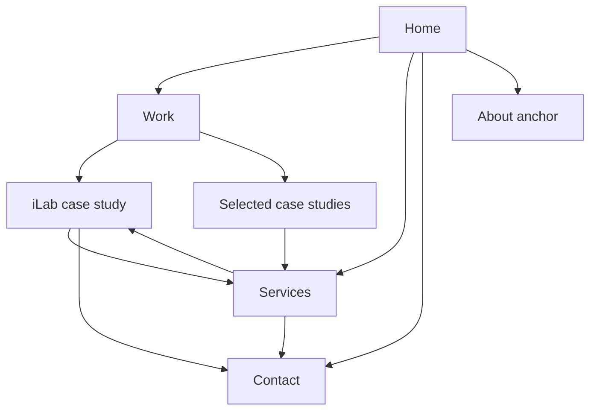

# Askold website — project plan

Updated: 2026-11-15. Milestone 1: complete, pending creative review. Discovery, direction and application foundation are delivered. Local development only; do not start Milestone 2 before review.

## Purpose and boundaries

Attract clients for independent web design, custom development, e-commerce, SEO and ongoing optimization. Preserve Askold's authored marble-to-bonsai sequence while making services, proof and contact easier to find. Speak as an independent practitioner; do not imply an unverified agency team.

Destination: this repository (`askoldas/askold-homepage`). Source: `../askold-cv-reference` (`askoldas/Cv`), strictly read only. No production hosting, DNS, deployment, source repository configuration or source file changes. No secrets, client records or invented results. Existing `.codex/` and `AGENTS.md` are preserved.

## Discovery

The source is Next.js 15.3.2 / React 19 with App Router, Sass modules and GSAP 3.13. The root client page manages section visibility and project modals. About, portfolio and contact are initially hidden until a hero action unlocks them. Six projects live in `src/data/portfolio.ts`; case studies are modals rather than addressable pages. A separate menu points to routes not represented by page files in the source. The contact form simulates delivery; no real submission integration was found.

The new site will use a server-rendered content architecture, normal document scrolling and real case-study URLs. Do not copy the source's hidden-content gate, global image optimization bypass, ignored lint failures or simulated form success.

## Website architecture

```text
Home (/)
├── Work (/work)
│   ├── iLab (/work/ilab)
│   └── Selected case studies (/work/[slug])
├── Services (/services)
└── Contact (/contact)
```

About remains `/#about` initially. Privacy information becomes a launch requirement when contact processing or analytics are selected; it is not an empty route in Milestone 1.



| Page | URL | Parent | Navigation | Purpose |
| --- | --- | --- | --- | --- |
| Home | `/` | — | Logo | Introduce, show proof, invite inquiry |
| Work | `/work` | Home | Header/footer | Selected evidence |
| iLab | `/work/ilab` | Work | Home feature, Work, Services | Flagship case study |
| Project | `/work/[slug]` | Work | Work and related cases | Verified scope and walkthrough |
| Services | `/services` | Home | Header/footer | Explain deliverables and fit |
| Contact | `/contact` | Home | Primary action/footer | Start a project |

Header order: Work, Services, About, Start a project. Footer: main routes, verified email/phone, selected social links and privacy link when required. No sidebar. Case studies have Home → Work → project breadcrumbs, related work, relevant service links and an inquiry action. Services link to supporting cases. Every published page must have an inbound link; essential pages should be one or two clicks away. Stable lowercase hyphenated slugs, no trailing slash. Check legacy indexed URLs before defining any production redirects; source menu labels do not establish live indexed pages.

Homepage order: artistic hero → business value → featured iLab → selected projects → services → why work directly with Askold → process → about → contact. The section arguments and composition are in `DESIGN_DIRECTION.md`.

## Application decisions

- Fresh Next.js App Router, TypeScript strict mode, React, Tailwind CSS 4 and GSAP. Lock dependency resolutions in npm's lockfile. Do not clone the old package/configuration defaults.
- Installed/pinned foundation versions: Next.js 16.4.6, React 19.3.1, GSAP 3.15.1, Tailwind CSS 4.3.5 and TypeScript 6.0.3. Node 22.22.2 was used locally. Fontsource families resolve to 5.3.0; `package.json` and `package-lock.json` record the exact toolchain.
- Server components for content and layouts. Client boundaries only for the later hero, navigation controls or real form interaction. No global animation provider or new state library.
- `src/app`: route/layout metadata; `src/components/ui` and `layout`: reusable foundations; `src/styles`: tokens; `src/content`: English copy; `src/lib`: locale helpers; `src/types`: evidence-aware project contract.
- English only now. Keep stable project IDs independent of translated names and copy separate from presentation. Future `lv`/`ru` dictionaries and locale route prefix strategy must be agreed before publication. Do not offer untranslated locale links or infer Latvian fluency from the intended locale list.
- Keep original media unmodified and copy only required files. Optimize derived media in this repository after visually verifying sequence fidelity. Preserve canonical intro hash in `ASSET_MANIFEST.md`.
- Load established font families locally; builds must not depend on a Google Fonts request. Retain font licenses.
- Milestone 1 is a restrained foundation specimen with noindex metadata, not the finished homepage. Only link to destinations that exist. No analytics, fake form, live client data, production canonical or deployment configuration.

## Milestones and Implementer handoff

| Milestone | Deliverables | Validation / stop rule |
| --- | --- | --- |
| 1 — Discovery and foundation | These four documents, new app, tokens, fonts, semantic layout/action primitives and typed content/evidence seams | Focused TypeScript, ESLint and production compile. No QA agent or full browser suite. Stop for creative review. |
| 2 — Signature foundation | Approved marble/bonsai hero, real navigation, mobile and reduced-motion/static states | QA review #1. Inspect actual scroll frames, native scroll, keyboard access, errors and representative viewports. Fix critical/high findings. |
| 3 — Full website | Nine-section homepage, Work/case routes, Services, Contact; verified imagery and content | Focused route/form/security checks, lint/typecheck/build. No full QA agent. Confirm scope and outcome evidence. |
| 4 — Release candidate | Metadata, redirect plan, final content/media, privacy/contact integration, analytics only when authorized | QA review #2 and comprehensive risk-based regression/accessibility/performance checks. Explicit approval before any production deployment. |

Implementer next tasks after direction review:

1. Compare decoded intro frames and the current live scroll behavior. Verify the relationship between the 2-second code range, 205vh trigger extent and 1.015-second MP4 duration before changing synchronization. The 105vh sticky hold reaches approximately 51.2% trigger progress and 1.024s playback, so the range may intentionally complete the clip just before the stage releases. Preserve the observed artwork sequence and pacing, including reverse scroll.
2. Build one scoped, cleaned-up GSAP hero controller. Gate seeking on metadata, coalesce seeks, handle fast/reverse scrolling, media errors and reduced-motion preference changes. Do not hide the rest of the site behind playback or CTA state.
3. Establish real responsive navigation and skip/anchor behavior. Use deliberate sculpture framing; avoid duplicating the clip download on mobile.
4. Capture authentic iLab desktop/mobile views in Milestone 3 and confirm role/scope before writing case-study claims. Implement optional evidence-backed results only when evidence exists.

## Coordination and skills

The orchestrator owns integration/documentation; Explorer owns discovery synthesis; Designer owns direction; Implementer owns application code. Specialist sessions in this run expose no filesystem tools: the orchestrator supplied actual repository/skill reads, received their findings and applies Implementer-authored code as a tool relay. No QA agent was started. Do not describe delegated findings as independent source verification.

Actual installed skills read/applied: `design-taste-frontend` (planning/direction draw), `frontend-design` (brand-specific type/composition), `web-design-guidelines` (foundation semantics/focus/media requirements), `site-architecture` (URL hierarchy/navigation/internal linking). Firecrawl and its `read-docs` workflow supplied live references and official installation guidance. Sites local-only workflow was read; no hosted Site was created. No SEO, accessibility audit or browser QA certification is claimed.

Direction draw: `uneven-photographs`, seed `144849104`, brand palette/type retained. The sculpture requirement overrides the generated hero; authentic project media overrides generic photo suggestions. Browser/scene gates and full copy implementation are explicitly deferred to their milestones per the user's scope.

## Verification and remaining inputs

Foundation check results are recorded in `QA_REPORT.md`; that file is a short execution record, not a Milestone 1 QA review. Production build does not authorize deployment.

No GA4/Search Console exports, verified iLab authorship breakdown, conversion baseline, client testimonials, current project permissions or real contact provider credentials were supplied. These do not block the foundation. See `ANALYTICS_REQUIREMENTS.md` for evidence needs. Reference Git status was clean at discovery; canonical intro hash was recorded. No source writes were performed.

Live sources inspected on 2026-11-15: [Askold](https://askold.me), [iLab service site](https://ilab.lv), [iLab shop](https://ilab.lv/shop). Setup guidance: [Next.js installation](https://nextjs.org/docs/app/getting-started/installation). Public page reads establish visible interfaces, not completed transactions, source architecture, ownership or commercial outcomes.
