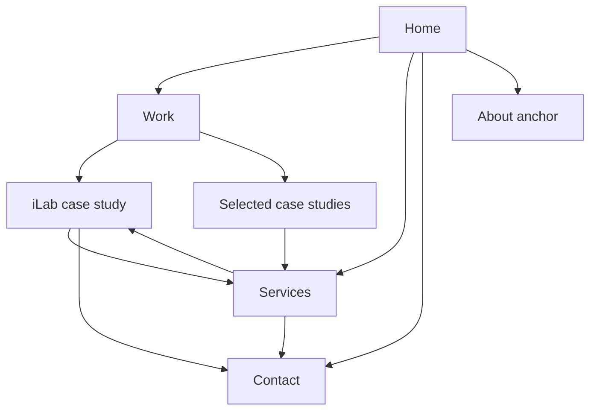

# Askold website — project plan

Updated: 2026-11-16. Milestones 1, 2, 2.1 and 3 are implemented. The signature hero is **not finally approved**: additional scroll-timing polish remains open. Stop at the Milestone 3 boundary. Local development only; no production deployment or Milestone 4 audit is authorized.

## Open visual approval task

- **Signature hero scroll timing: OPEN.** Preserve the original marble-to-bonsai artwork and synchronization. Additional pacing polish and user approval are still required; prior implementation/check completion does not constitute final creative approval.
- Visual evidence collected: ten full-page PNGs covering Home, Work, iLab, Services and Contact at desktop (1440px) and mobile (390px), saved locally in `.taste-skill/visual-review-after-milestone-3-2026-11-16/` (Git-ignored). Homepage stills retain the real scroll runway and opening animation state. Independent design review remains pending; evidence collection does not begin Milestone 4 or authorize redesign, fixes or QA audits.

## Purpose and boundaries

Attract clients for independent web design, custom development, e-commerce, SEO and ongoing optimization. Preserve Askold's authored marble-to-bonsai sequence while making services, proof and contact easier to find. Speak as an independent practitioner; do not imply an unverified agency team.

Destination: this repository (`askoldas/askold-homepage`). Source: `../askold-cv-reference` (`askoldas/Cv`), strictly read only. No production hosting, DNS, deployment, source repository configuration or source file changes. No secrets, client records or invented results. Existing `.codex/` and `AGENTS.md` are preserved.

## Discovery

The source is Next.js 15.3.2 / React 19 with App Router, Sass modules and GSAP 3.13. The root client page manages section visibility and project modals. About, portfolio and contact are initially hidden until a hero action unlocks them. Six projects live in `src/data/portfolio.ts`; case studies are modals rather than addressable pages. A separate menu points to routes not represented by page files in the source. The contact form simulates delivery; no real submission integration was found.

The new site will use a server-rendered content architecture, normal document scrolling and real case-study URLs. Do not copy the source's hidden-content gate, global image optimization bypass, ignored lint failures or simulated form success.

## Website architecture

```text
Home (/)
├── Work (/work)
│   ├── iLab (/work/ilab)
│   └── Selected case studies (/work/[slug])
├── Services (/services)
└── Contact (/contact)
```

About remains `/#about` initially. Privacy information becomes a launch requirement when contact processing or analytics are selected; it is not an empty route in Milestone 1.



| Page | URL | Parent | Navigation | Purpose |
| --- | --- | --- | --- | --- |
| Home | `/` | — | Logo | Introduce, show proof, invite inquiry |
| Work | `/work` | Home | Header/footer | Selected evidence |
| iLab | `/work/ilab` | Work | Home feature, Work, Services | Flagship case study |
| Project | `/work/[slug]` | Work | Work and related cases | Verified scope and walkthrough |
| Services | `/services` | Home | Header/footer | Explain deliverables and fit |
| Contact | `/contact` | Home | Primary action/footer | Start a project |

Header order: Work, Services, About, Start a project. Footer: main routes, verified email/phone, selected social links and privacy link when required. No sidebar. Case studies have Home → Work → project breadcrumbs, related work, relevant service links and an inquiry action. Services link to supporting cases. Every published page must have an inbound link; essential pages should be one or two clicks away. Stable lowercase hyphenated slugs, no trailing slash. Check legacy indexed URLs before defining any production redirects; source menu labels do not establish live indexed pages.

Homepage order: artistic hero → business value → featured iLab → selected projects → services → why work directly with Askold → process → about → contact. The section arguments and composition are in `DESIGN_DIRECTION.md`.

## Application decisions

- Fresh Next.js App Router, TypeScript strict mode, React, Tailwind CSS 4 and GSAP. Lock dependency resolutions in npm's lockfile. Do not clone the old package/configuration defaults.
- Installed/pinned foundation versions: Next.js 16.4.6, React 19.3.1, GSAP 3.15.1, Tailwind CSS 4.3.5 and TypeScript 6.0.3. Node 22.22.2 was used locally. Fontsource families resolve to 5.3.0; `package.json` and `package-lock.json` record the exact toolchain.
- Server components for content and layouts. Client boundaries only for the later hero, navigation controls or real form interaction. No global animation provider or new state library.
- `src/app`: route/layout metadata; `src/components/ui` and `layout`: reusable foundations; `src/styles`: tokens; `src/content`: English copy; `src/lib`: locale helpers; `src/types`: evidence-aware project contract.
- English only now. Keep stable project IDs independent of translated names and copy separate from presentation. Future `lv`/`ru` dictionaries and locale route prefix strategy must be agreed before publication. Do not offer untranslated locale links or infer Latvian fluency from the intended locale list.
- Keep original media unmodified and copy only required files. Optimize derived media in this repository after visually verifying sequence fidelity. Preserve canonical intro hash in `ASSET_MANIFEST.md`.
- Load established font families locally; builds must not depend on a Google Fonts request. Retain font licenses.
- Milestone 1 is a restrained foundation specimen with noindex metadata, not the finished homepage. Only link to destinations that exist. No analytics, fake form, live client data, production canonical or deployment configuration.

## Milestones and Implementer handoff

| Milestone | Deliverables | Validation / stop rule |
| --- | --- | --- |
| 1 — Discovery and foundation | These four documents, new app, tokens, fonts, semantic layout/action primitives and typed content/evidence seams | Focused TypeScript, ESLint and production compile. No QA agent or full browser suite. Stop for creative review. |
| 2 — Signature foundation | Approved marble/bonsai hero, real navigation, mobile and reduced-motion/static states | QA review #1. Inspect actual scroll frames, native scroll, keyboard access, errors and representative viewports. Fix critical/high findings. |
| 3 — Full website | Nine-section homepage, Work/case routes, Services, Contact; verified imagery and content | Focused route/form/security checks, lint/typecheck/build. No full QA agent. Confirm scope and outcome evidence. |
| 4 — Release candidate | Metadata, redirect plan, final content/media, privacy/contact integration, analytics only when authorized | QA review #2 and comprehensive risk-based regression/accessibility/performance checks. Explicit approval before any production deployment. |

Implementer next tasks after direction review:

1. Compare decoded intro frames and the current live scroll behavior. Verify the relationship between the 2-second code range, 205vh trigger extent and 1.015-second MP4 duration before changing synchronization. The 105vh sticky hold reaches approximately 51.2% trigger progress and 1.024s playback, so the range may intentionally complete the clip just before the stage releases. Preserve the observed artwork sequence and pacing, including reverse scroll.
2. Build one scoped, cleaned-up GSAP hero controller. Gate seeking on metadata, coalesce seeks, handle fast/reverse scrolling, media errors and reduced-motion preference changes. Do not hide the rest of the site behind playback or CTA state.
3. Establish real responsive navigation and skip/anchor behavior. Use deliberate sculpture framing; avoid duplicating the clip download on mobile.
4. Capture authentic iLab desktop/mobile views in Milestone 3 and confirm role/scope before writing case-study claims. Implement optional evidence-backed results only when evidence exists.

## Coordination and skills

The orchestrator owns integration/documentation; Explorer owns discovery synthesis; Designer owns direction; Implementer owns application code. Specialist sessions in Milestones 1–2 expose no filesystem/browser tools: the orchestrator supplied actual reads and measurements and applied Implementer-authored changes as a tool relay. No QA agent was used in Milestone 1. Milestone 2 QA review #1 assessed the orchestrator's rendered-browser evidence; it was not an independently executed browser audit.

Actual installed skills read/applied: `design-taste-frontend` (planning/direction draw), `frontend-design` (brand-specific type/composition), `web-design-guidelines` (foundation semantics/focus/media requirements), `site-architecture` (URL hierarchy/navigation/internal linking). Firecrawl and its `read-docs` workflow supplied live references and official installation guidance. Sites local-only workflow was read; no hosted Site was created. No SEO, accessibility audit or browser QA certification is claimed.

Direction draw: `uneven-photographs`, seed `144849104`, brand palette/type retained. The sculpture requirement overrides the generated hero; authentic project media overrides generic photo suggestions. Browser/scene gates and full copy implementation are explicitly deferred to their milestones per the user's scope.

## Verification and remaining inputs

Foundation check results are recorded in `QA_REPORT.md`; that file is a short execution record, not a Milestone 1 QA review. Production build does not authorize deployment.

No GA4/Search Console exports, verified iLab authorship breakdown, conversion baseline, client testimonials, current project permissions or real contact provider credentials were supplied. These do not block the foundation. See `ANALYTICS_REQUIREMENTS.md` for evidence needs. Reference Git status was clean at discovery; canonical intro hash was recorded. No source writes were performed.

Live sources inspected on 2026-11-15: [Askold](https://askold.me), [iLab service site](https://ilab.lv), [iLab shop](https://ilab.lv/shop). Setup guidance: [Next.js installation](https://nextjs.org/docs/app/getting-started/installation). Public page reads establish visible interfaces, not completed transactions, source architecture, ownership or commercial outcomes.

## Milestone 2 delivery and review

Implemented in `src/components/hero/signature-foundation.tsx` and its CSS module: responsive header/native mobile disclosure; original scroll-synchronized film; stable accessible heading with visual intro/outro layers; persistent inquiry/work actions; skip-animation link; short business-value bridge. The root route remains the only implemented page. Work links use the current live portfolio until Milestone 3 supplies `/work`; contact uses the verified public mailto address. No placeholder cases or unbuilt route links were added.

Desktop preserves approximately 105svh of sticky travel inside a 205svh wrapper. Playback maps that hold to the original film's verified duration, stopping inside its final frame. Compact layouts use normal flow and finish the reveal while the entire portrait is still visible, then hold the final frame as the visitor scrolls into the bridge. Oversized text disables desktop sticky holding. The original MP4 was not edited or re-encoded.

Performance/accessibility decisions: one paused, muted inline video; metadata/data readiness gates; coalesced rAF seeks with in-flight backpressure; exact seeking rather than keyframe snapping; no React state changes per scrub frame; cleanup of triggers, timelines, animation frames, media/resize/preference listeners and observers. Reduced motion avoids the video request and scroll runway, showing a lossless final-frame still. Failed video and disabled scripting retain content/actions. Font loading uses only the three weights currently rendered. No new npm dependencies were added.

Designer reviewed relayed geometry against the installed design skills. QA review #1 began only after the complete foundation was built. It identified and closed mobile initial-progress, enlarged-text overflow and final-reveal visibility defects, plus minor glyph/lint issues. Only affected checks were repeated. Final TypeScript, ESLint (zero warnings) and production build passed. See `QA_REPORT.md` for measured scope and limitations.

Skills applied in Milestone 2: installed `design-taste-frontend`, `frontend-design`, `web-design-guidelines`, `web-perf`, `webapp-testing` workflow and `accessibility-audit` checklist. The browser connector was unavailable and Python was not runnable, so actual rendering/interactions used the installed taste skill's zero-dependency CDP/Chrome helper rather than Python Playwright. Official GSAP/currentTime documentation was retrieved through the existing Firecrawl workflow. This adaptation is recorded rather than described as an independent Playwright run.

No Explorer was needed for this focused continuation. No production hosting/DNS changes, source repository writes, contact backend, analytics or Milestone 3 sections were introduced. The original source working tree remains clean. The local Next dev server's automatic AGENTS appendix was removed and `agentRules: false` prevents recurrence; project instructions are unchanged.

Next boundary: review this hero before implementing the full portfolio, iLab case, service/about/process sections or additional routes. Carry forward the release validation items in `QA_REPORT.md`.

## Milestone 2.1 — deliberate, reversible hero scene

The user's manual review exposed a pacing problem that the Milestone 2 endpoint checks missed. Its desktop trigger mapped the complete film across only 105svh (945px at 1440×900); compact layouts used roughly 149–349px in the measured landscape/phone views. It was local hero progress, not document-wide progress. Missing opening/final holds and the short compact range made ordinary gestures advance too much. The reference uses a 205vh wrapper, sticky stage and separate video/text triggers; its root also locks later content behind a CTA. The new scene retains the artwork and typing principles without that lock.

This refinement supersedes the Milestone 2 geometry and the earlier mobile normal-flow direction:

- `HERO_SCROLL` in `src/components/hero/signature-foundation.tsx` sets active travel to **3.5 viewport heights desktop / 2.5 compact**. A stable `100svh` ruler supplies pixels; wrapper height equals travel plus the viewport-height stage. Compact means width ≤760px or height ≤620px. Adding content below the hero does not affect its range.
- One CSS sticky stage, no GSAP pin. ScrollTrigger starts at `top top`, ends at the explicit local distance and scrubs one timeline with 0.3s smoothing. The timeline's update callback drives both typed text and video targets; raw trigger progress never drives normal video seeking.
- 0–15%: intact sculpture/greeting hold. 15–25%: erase greeting. 25–45%: type “Make your ideas visible.” Artwork advances through its first 20% during 15–45%, then completes during 45–80%. Bonsai holds through 100%; final headline/value copy crossfade during 80–85% and remain readable until release.
- Mobile contains the full original portrait between short copy and persistent contact/work/skip controls. Oversized text switches to ordinary flow without an extended spacer. Reduced motion and video failure retain static artwork and accessible content.
- Initial hash destinations are restored once after the active runway is established. A refresh-only reconciliation resolves geometry changes before ordinary scrubbing resumes; it never forces visitors back to an anchor during later scrolling. All added callbacks are cleaned up.

Designer reviewed timing/composition and Implementer authored the controller/CSS plus focused fixes. Their sessions lacked tools, so the orchestrator applied their prepared changes and executed the browser checks. One focused QA review assessed that relayed evidence after the complete revision; only affected paths were repeated after its two P1 fixes. See `QA_REPORT.md` for results and physical-device limitations. Existing performance techniques, original MP4 bytes and repository boundaries are preserved. No dependencies, Milestone 3 sections or deployment changes were added.

## Milestone 3 — complete commercial website

Implemented in the existing application; no reinitialization or added dependencies. The signature controller, scroll distances, choreography and hero CSS were preserved. Integration changes expose the existing header for interior pages, connect Work/Services/Contact to real routes and accept server-rendered homepage content below the hero. The footer sits outside the main landmark.

| Route | Delivered content |
| --- | --- |
| `/` | Approved hero → commercial value → flagship iLab → Frio Estrella/Latvir selected work → six service offers → direct collaboration → five-stage process → concise Askold introduction → project inquiry invitation |
| `/work` | iLab lead feature, unequal project compositions and five linked project presentations |
| `/work/ilab` | Overview, challenge, design/responsive decisions, repair-service hierarchy, parts finder, catalog, verified service-site SEO architecture and delivered qualitative outcome |
| `/work/frio-estrella` | Service information, responsive presentation, interactive estimate and quote journey |
| `/work/latvir` | Sensitive-service information hierarchy, immediate contact, service/FAQ structure and mobile presentation |
| `/work/fixmobile` | Original identity/storefront and product-page material, with archive context |
| `/work/seoquill` | Original service presentation, custom ordering interface and full homepage material |
| `/services` | Design/redesign, custom development, e-commerce, applications, SEO/performance and support; deliverables, fit, supporting case links and inquiry actions |
| `/contact` | Short project form opening an encoded email draft; selectable/copyable fallback, direct email and verified WhatsApp |

Shared case pages use a short summary before the authentic primary image and preserve longer context and scope below it, making the work visible earlier on mobile. Every case has breadcrumbs, related projects, service and contact routes. Unknown project slugs return 404; the published project list is statically generated. English content is separate from presentation with stable project IDs; no unimplemented language switcher is shown.

### Evidence and media

Ten fresh public desktop/mobile screenshots and five optimized derivatives from original FixMobile/SeoQuill material are used. Exact sources, viewports and dimensions are in `ASSET_MANIFEST.md`. The live iLab, shop, repair page, Frio Estrella and Latvir interfaces were inspected. A read-only Frio calculator service change updated its estimate. This verifies interface response, not pricing accuracy or form delivery. No private administration, checkout, account or transaction tests were performed on client websites. No iLab source repository was accessible; owner-supplied scope and public observations are distinguished in `ANALYTICS_REQUIREMENTS.md`.

There are no fabricated metrics, testimonials, client outcomes, launch dates or experience totals. The existing `VerifiedProjectResult` contract and conditional results component accept approved GA4/Search Console data and baseline comparisons; no metric section is rendered without data. Each public case has a complete qualitative outcome instead of placeholder figures.

### SEO and contact contracts

Unique titles/descriptions, canonical URLs, Open Graph/Twitter metadata, a studio social-preview image, Person/CreativeWork/Breadcrumb structured data, `/sitemap.xml` and `/robots.txt` are implemented. Canonicals use the intended `https://askold.me` URLs without modifying that domain. **`SITE_INDEXABLE` defaults to false**; noindex/nofollow and robots disallow remain until an explicit release decision. Avoid treating enabling this build-time flag as deployment authorization.

The inquiry form validates bounded fields, encodes an email draft and preserves entered content. No HTTP inquiry submission, provider integration, storage or delivery confirmation exists. A denied clipboard request selects the draft for manual copying; a copied message appears only after the clipboard call succeeds. Native mailto POST/text/plain prevents a no-JS fallback from sending inquiry fields in a local GET URL. Email and WhatsApp remain direct alternatives. See analytics documentation before adding delivery or measurement providers.

### Coordination, verification and next boundary

Designer supplied concrete layout and mobile case-hero direction through relayed project/skill reads; Explorer performed bounded read-only source/asset research; Implementer edited all application code directly and ran TypeScript, lint and production build. Orchestrator captured/optimized authentic media, maintained documentation and ran limited development checks. The earlier tool-relay limitation does not describe the Milestone 3 Implementer's direct execution.

Installed skills applied: `design-taste-frontend`, `frontend-design`, `web-design-guidelines`, `site-architecture`, `programmatic-seo` (structured unique cases, hub/spoke links and controlled indexing; no generated thin pages), `web-perf` (media/loading restraint, without a full audit), and Firecrawl for public source retrieval. No QA agent, full browser suite, accessibility audit or performance audit was invoked.

TypeScript, lint and production build passed. HTTP checks cover all nine pages, unknown-case 404, sitemap, robots and social-image response. Limited rendered checks cover the new homepage feature, mobile iLab page/image, navigation destinations and form validation/draft/clipboard-denied fallback. No email was sent and no inquiry POST occurred. Final affected mobile case composition was checked after its layout adjustment. The local preview is restored for review.

**Milestone 4 remains unstarted.** Remaining release work: comprehensive visual/responsive/accessibility/browser/performance review; Safari/iOS and physical-device touch momentum; native text zoom; real mail-client behavior; analytics evidence/provider/consent and optional form-delivery integration; production indexing, legacy redirects, final content approvals and deployment approval. No hosting/DNS or reference-repository changes were made.

## Milestone 3.5 rollback

The visual refinement was rejected and rolled back to the Milestone 3 application. Git contained only the Milestone 1 commit; the seven affected originals were recovered from exact pre-edit reads and recorded inverse changes, reviewed before restoration. Both components introduced in 3.5 were removed. The current 3.5 files were backed up with verified hashes before any restoration; unrelated Milestones 1–3 files were preserved.

All nine page routes and focused original-component checks pass. TypeScript, lint and production build pass; all 14 static/SSG outputs generated. No redesign or Milestone 4 work was performed. The baseline is restored for manual refinement, with hero scroll-timing polish and final creative approval still open.
